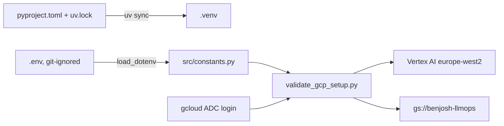

# Learning log

Chronological record of each step: what we built, what we observed, what went wrong.
Concepts are explained in depth in [concepts.md](concepts.md).

## 2026-11-10 · M0 · Project setup

**In plain words:** we set up the workshop before building anything: a reproducible Python toolbox, a private place for settings and secrets, access to Google Cloud, a shared cloud drive (bucket), and a quick check that it all connects.

**Class link:** Session 1 slides 21-23 (deployment problem, Git and virtual environments, environment variables), slides 27-28 (testing, IAM, why the cloud). Practice 1 sections 1-3. Starting code: teacher's Session 2 solution (`Practice/session2_code.zip`).

**Other course link:** MSA-DATI07-01 (Python project with version control and requirements), Data Engineering (GCP and GCS). See concepts 1 to 7 in [concepts.md](concepts.md).

**What we built:**

| Commit | Change |
|---|---|
| `d8b6ded` | CLAUDE.md with decisions and working rules |
| `d85e960` | Teacher's Session 1-2 solution imported unchanged (junk files removed, example env values blanked) |
| `0367999` | Project renamed, `python-dotenv` added and `.env` loaded in `src/constants.py`, `OPENAI_API_KEY` in `.env.example` |
| `bc9c56c` | README skeleton with setup steps and dataset citation |
| `2989161` | CLAUDE.md: three-layer teaching protocol, concepts sheet, M0 settings |

Outside the repo:
- gcloud configuration `llmops` (project `agentics-workflows-510809`), keeping the Data Engineering profile intact
- Bucket created: `gcloud storage buckets create gs://benjosh-llmops --project=agentics-workflows-510809 --location=EU --uniform-bucket-level-access`
- Teacher `MathieuHS` invited as collaborator (write access)

**Result:**
- `gcloud storage buckets describe` reports: `benjosh-llmops`, location `EU`, type `multi-region`, uniform access `True`
- `uv run python -m scripts.validate_gcp_setup` printed: Vertex AI connectivity successful, GCS bucket access successful, "All validations passed! GCP setup is ready."
- `.venv/` size measured with `du -sh`: 409M

**Problems hit and fixes:**
- The teacher's code reads `os.getenv(...)` but nothing loaded `.env`. Fix: `python-dotenv` and `load_dotenv()` in `src/constants.py`.
- The teacher's `.env.example` held the teacher's real project ID, and our repo is public. Fix: placeholders.
- gcloud tokens had expired and need a browser login, which the assistant cannot do. Fix: Dhia ran the login commands himself.
- Requested bucket name `BenJosh-llmops`: GCS names must be lowercase. Fix: `benjosh-llmops`.
- Teammate invitation for `sjoshi.rgb` returned 404: GitHub usernames cannot contain dots. Open: get the exact GitHub username.
- T4 quota region not yet verified (the Cloud Quotas API is not enabled on the project). Open: check in the console before M2.

**Exam-style question:** A teammate clones the repo, runs `uv sync`, and the validation script reports a bucket access failure on bucket `None`. Explain why and how to fix it.
**Answer:** `.env` is git-ignored, so the clone has none. `os.getenv("GCP_BUCKET_NAME")` returns `None`. The teammate copies `.env.example` to `.env`, fills in the values, and runs `gcloud auth application-default login` so the Python libraries have credentials.
