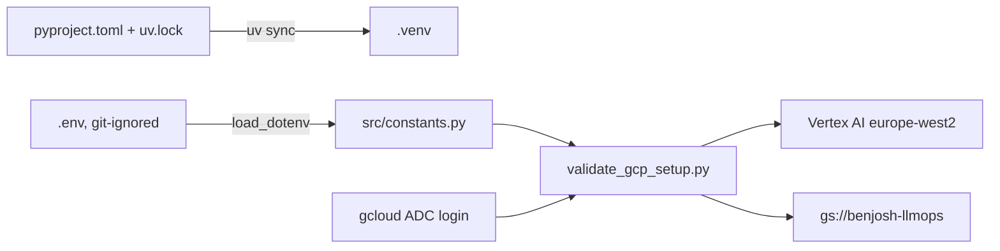
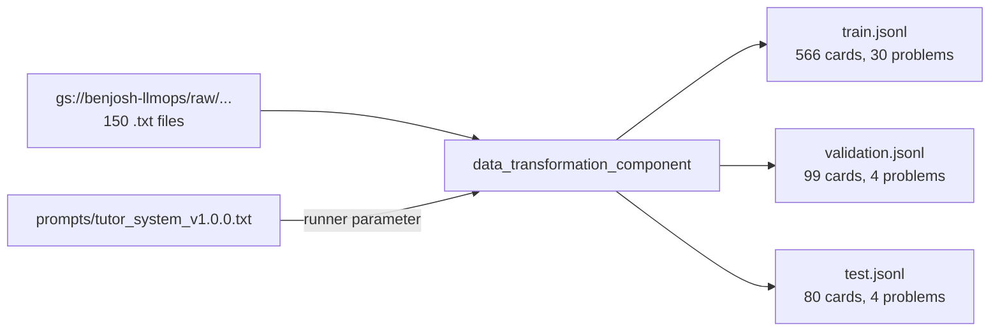

# Learning log

Chronological record of each step: what we built, what we observed, what went wrong.
Concepts are explained in depth in [concepts.md](concepts.md).

## 2026-11-10 · M0 · Project setup

**In plain words:** we set up the workshop before building anything: a reproducible Python toolbox, a private place for settings and secrets, access to Google Cloud, a shared cloud drive (bucket), and a quick check that it all connects.

**Class link:** Session 1 slides 21-23 (deployment problem, Git and virtual environments, environment variables), slides 27-28 (testing, IAM, why the cloud). Practice 1 sections 1-3. Starting code: teacher's Session 2 solution (`Practice/session2_code.zip`).

**Other course link:** MSA-DATI07-01 (Python project with version control and requirements), Data Engineering (GCP and GCS). See concepts 1 to 7 in [concepts.md](concepts.md).

**What we built:**

| Commit | Change |
|---|---|
| `d8b6ded` | CLAUDE.md with decisions and working rules |
| `d85e960` | Teacher's Session 1-2 solution imported unchanged (junk files removed, example env values blanked) |
| `0367999` | Project renamed, `python-dotenv` added and `.env` loaded in `src/constants.py`, `OPENAI_API_KEY` in `.env.example` |
| `bc9c56c` | README skeleton with setup steps and dataset citation |
| `2989161` | CLAUDE.md: three-layer teaching protocol, concepts sheet, M0 settings |

Outside the repo:
- gcloud configuration `llmops` (project `agentics-workflows-510809`), keeping the Data Engineering profile intact
- Bucket created: `gcloud storage buckets create gs://benjosh-llmops --project=agentics-workflows-510809 --location=EU --uniform-bucket-level-access`
- Teacher `MathieuHS` invited as collaborator (write access)

**Result:**
- `gcloud storage buckets describe` reports: `benjosh-llmops`, location `EU`, type `multi-region`, uniform access `True`
- `uv run python -m scripts.validate_gcp_setup` printed: Vertex AI connectivity successful, GCS bucket access successful, "All validations passed! GCP setup is ready."
- `.venv/` size measured with `du -sh`: 409M

**Problems hit and fixes:**
- The teacher's code reads `os.getenv(...)` but nothing loaded `.env`. Fix: `python-dotenv` and `load_dotenv()` in `src/constants.py`.
- The teacher's `.env.example` held the teacher's real project ID, and our repo is public. Fix: placeholders.
- gcloud tokens had expired and need a browser login, which the assistant cannot do. Fix: Dhia ran the login commands himself.
- Requested bucket name `BenJosh-llmops`: GCS names must be lowercase. Fix: `benjosh-llmops`.
- Teammate invitation for `sjoshi.rgb` returned 404: GitHub usernames cannot contain dots. Fix: the real username is `sjoshi-rgb`, invited.
- T4 quota region: the Cloud Quotas API is not enabled on the project, so it was not read automatically. Dhia confirmed the quota is in `europe-west2`, which matches `GCP_REGION`.

**Exam-style question:** A teammate clones the repo, runs `uv sync`, and the validation script reports a bucket access failure on bucket `None`. Explain why and how to fix it.
**Answer:** `.env` is git-ignored, so the clone has none. `os.getenv("GCP_BUCKET_NAME")` returns `None`. The teammate copies `.env.example` to `.env`, fills in the values, and runs `gcloud auth application-default login` so the Python libraries have credentials.

## 2026-11-12 · M1 · Data: exploration, component, tests

**In plain words:** we turned the benchmark's conversation files into flashcards (conversation so far, then the next tutor line), split them by problem so the test set never contains a bug seen in training, and checked every number on the real data before using the cloud.

**Class link:** Session 2 slides 16-25 (SFT, chat template, tokenization, data cleaning, step philosophy), slides 6-14 (component, artifact, pipeline, job). Practice 2 sections 1-3. Concepts 8 to 12 in [concepts.md](concepts.md).

**Other course link:** Generative AI I (next-token prediction), Data Engineering (pipelines), earlier ML course for train/test splits (to confirm).

**What we built:**

- Raw data uploaded unchanged from dataset commit `3f77f89`: 150 files, 606,236 bytes
- Component rewritten: parse sections and turns, one card per tutor turn, dedup, split by problem with seed 42, JSONL output, error if a problem is in two splits
- 19 unit tests on synthetic fixtures (`uv run pytest`), all passing
- Exploration notebook [01_explore_dataset.py](../notebooks/01_explore_dataset.py) runs the same function locally; figures in [results/m1_dataset_stats.md](results/m1_dataset_stats.md)

**Result:** train 566, validation 99, test 80 cards. Longest card 2,066 tokens (limit 4,096, none over). Phi-3 template keeps the system block. For comparison, the Yoda practice dataset has 720 rows.

**Problems hit and fixes:**
- Two file names have typos (`socratic_thread`, `conversational_thead`): any non-`socratic_dialogue` file counts as a thread, tested
- The teacher's CSV output would flatten the message lists into strings: JSONL instead
- The teacher's random row split would leak dialogues between train and test: split by problem
- Scratch copy of the dataset vanished between sessions: re-cloned at the same commit
- gcloud CLI login expired again (school account): upload done through the Python client, which uses Application Default Credentials
- A shell variable bug made the first upload send 0 files: caught by the count check, fixed and re-run
- Running the notebook from `notebooks/` could not import `src`, and the chat template needed `jinja2`: both fixed

**Exam-style question:** Why does the data component raise an error when a problem appears in two splits, instead of just logging a warning?
**Answer:** A shared problem means the test cards contain bugs and dialogues seen in training, so every later score (M3, M4) would overstate the model. Failing loudly stops a leaky dataset from ever reaching fine-tuning.

## 2026-11-12 · M1 · Decisions: deduplication, code attribution, system prompt

**In plain words:** reading the data closely showed two defects that would have taught the wrong behaviour or weighted some cards twice, and the system prompt became a versioned file that every step reads from.

**Class link:** Session 2 slide 22 (data cleaning), syllabus learning outcome 5 (prompt versioning), Session 1 slides 18, 20, 21. Concepts 13 to 15 in [concepts.md](concepts.md).

**Other course link:** pandas `drop_duplicates` / SQL `DISTINCT` (to confirm); package version pins from M0 (concept 1).

**What we decided and built:**

| Decision | Rule | Effect measured |
|---|---|---|
| Code attribution | `<code>` after a tutor line goes to the next student turn | 7 tutor targets with the corrected function removed; 0 targets with a code block now; longest validation target 223 to 49 tokens |
| Dedup | Normalised exact match over all messages: ignore spacing, backticks, end-of-word `, . ! ? ; :`; keep case, operators, in-word punctuation | train folder 679 to 665, testset 83 to 80; 0 merged groups differ in letter case |
| No fuzzy dedup | Rejected | would have removed 30 more cards, including genuinely different conversations, with an arbitrary threshold |
| System prompt v1.0.0 | One file, loaded by version; text and version passed as pipeline parameters; `prompt_version` on every card; guard test | 120 tokens; `<|system|>` block kept by the Phi-3 template |
| Model revision | Pin `f39ac1d` for tokenizer and weights everywhere | tokenizer loaded at that revision in the notebook |

Recorded for later milestones (CLAUDE.md section 8): M3 three setups (base without prompt, base + prompt, fine-tuned + prompt) and a leak metric calibrated on human tutor replies; M4 adversarial and off-topic triples; M5 prompt added server-side only; M7 prompt version in Langfuse.

**Problems hit and fixes:**
- Dhia spotted the misattributed `<code>` block in `66_69_last_index_of`; the scan found 8 such files in `train/`, none in `testset/`
- Correction of an earlier claim: the 7 tutor targets with code blocks had been described as "terminal experiments"; they were in fact these misattributed student fixes
- First dedup idea removed all punctuation; replaced by end-of-word punctuation only, so `1.5` and `15` cannot merge

**Exam-style question:** The training data contains no student asking "just give me the fixed code". Where does the tutor's refusal come from, and how do we know it works?
**Answer:** Only from the system prompt, since fine-tuning never showed that situation. We cannot assume it works: M4 adds adversarial triples (asking for the answer, prompt injection, off-topic) and the CI gate fails if the tutor leaks a fix on them.

## 2026-11-12 · M1 · Data step on Vertex AI

**In plain words:** the data step ran in the cloud, as the first workstation of the assembly line, and produced exactly the same flashcards as on the laptop.

**Class link:** Session 2 slides 13-14 (job submission, Vertex console, artifacts in the pipeline root). Practice 2 section 3. Concept 12 in [concepts.md](concepts.md).

**What we ran:** `uv run python -m scripts.pipeline_runner` (launched by Dhia). Job `model-training-pipeline-20261112142518`, parameters: prompt v1.0.0, 4 validation problems, seed 42.

**Result:**
- State `SUCCEEDED`; the data component ran in 184 s (13:25:23 to 13:28:29 UTC)
- Outputs under `gs://benjosh-llmops/vertexai-pipeline-root/123905721265/model-training-pipeline-20261112142518/data-transformation-component_5095698870994731008/`: `train_dataset`, `validation_dataset`, `test_dataset`
- Downloaded and compared with a local run of the same code: train 566, validation 99, test 80 cards; validation problems 1, 9, 18, 20; test problems 6, 7, 15, 24; `prompt_version` 1.0.0 on every card; **identical to the local output, card for card**

**Problem hit and fix:**
- The GCP project `agentics-workflows-510809` is shared by the class (20 buckets, other teams' pipelines). Our bucket uses default project permissions: any project editor can read, overwrite or delete our files. Consequences: no secrets in the bucket, verify artifacts rather than trust them, and the T4 quota in europe-west2 is shared, so M2 jobs may queue
- The monitoring script crashed after the job ended (it read a field that does not exist on a successful job); the job itself was unaffected

**Exam-style question:** Why compare the Vertex output with a local run instead of trusting the green tick in the console?
**Answer:** A green tick only says the code ran without error. Comparing outputs proves the cloud run used the same data, parameters and code as the version we tested; here the files were identical, so the 20 unit tests and the notebook figures also describe what M2 will train on.
