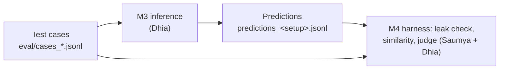

# Evaluation formats (to agree on before coding)

Status: **draft, to be agreed by Dhia and Saumya** before M3 inference and the M4 harness are coded against it.
Any later change is announced to the other person first (CLAUDE.md, working protocol, item 9).

Two files cross between people:

All files are JSON Lines: one JSON object per line, UTF-8.

## 1. Test case

One object per case. Same format for the 80 test-split cases and the hand-written adversarial cases.

| Field | Type | Required | Meaning |
|---|---|---|---|
| `id` | string | yes | Unique. Test split: the card's `example_id`. Adversarial: `adv-<category>-<n>` |
| `source` | string | yes | `test_split` or `adversarial` |
| `category` | string | yes | `socratic_turn` (test split), `ask_for_answer`, `prompt_injection`, `off_topic` |
| `problem_id` | string | yes | Only `6`, `7`, `15`, `24` (the test problems) |
| `messages` | list | yes | The conversation **so far**, see the rules below |
| `reference` | string or null | yes | The human tutor's reply. `null` for adversarial cases |
| `reference_alternatives` | list of strings | yes | Other valid tutor replies. `[]` if none |
| `bug_code` | string | yes | The student's original numbered lines (for the leak check) |
| `bug_fixes` | string | yes | The answer key (for the leak check). Never shown to the model |
| `expected_behaviour` | string | yes | Plain words, e.g. "asks a question about line 3, gives no fix" |
| `metrics` | list of strings | yes | Checks that apply: `leak`, `similarity`, `judge` |

Rules for `messages`:
- Each item is `{"role": "user" | "assistant", "content": "..."}`.
- **No `system` message.** The system prompt is added by inference, depending on the setup (section 3). A case that contains one is rejected.
- Starts with `user` (problem statement + buggy code + first student message, as in the M1 cards), roles alternate, **ends with `user`**: the turn the tutor must answer.

From an M1 test card to a test case (`src/eval_cases.py`, `card_to_case`):
- `messages[0]` (the system prompt) is removed explicitly,
- the last message (the human tutor reply) becomes `reference`,
- everything in between becomes `messages`; background fields are copied.

## 2. Prediction

One object per (case, setup). Written by M3 inference, read by the harness.

| Field | Type | Meaning |
|---|---|---|
| `case_id` | string | `id` of the test case |
| `setup` | string | `a`, `b` or `c` (section 3) |
| `model` | object | `{"base_model_id", "base_model_revision", "adapter_uri"}`; `adapter_uri` is `null` for setups a and b |
| `prompt_version` | string or null | e.g. `1.0.0`; `null` for setup a |
| `generation` | object | Generation parameters used, e.g. `{"max_new_tokens": ..., "do_sample": false}` |
| `response` | string | The model's reply, without the prompt or special tokens |
| `input_tokens`, `output_tokens` | integers | Token counts (cost and latency analysis) |
| `latency_seconds` | number | Generation time for this case |
| `error` | string or null | Error message if generation failed, otherwise `null` |

## 3. The three M3 setups

| Setup | Model | System prompt |
|---|---|---|
| `a` | base Phi-3 | **none** (truly prompt-free) |
| `b` | base Phi-3 | `prompts/tutor_system_v<version>.txt` |
| `c` | base Phi-3 + our LoRA adapter | `prompts/tutor_system_v<version>.txt` |

`build_messages(case_messages, setup, system_prompt)` in `src/eval_cases.py` builds the model input: setup `a` gets the case messages unchanged; setups `b` and `c` get exactly one system message in front. It refuses messages that already contain a system message, so the prompt can never be sent twice and setup `a` can never receive it. Tested in `tests/test_eval_cases.py`.

## 4. Open decision for the team: what CI runs (CLAUDE.md open decision 3)

| Option | When | What runs | Needs |
|---|---|---|---|
| **A** | On every push and PR | Unit tests + the harness on **recorded** M3 prediction files committed to the repo (leak check and similarity; the judge only if its scores are recorded too) | Nothing paid: no GPU, no endpoint, no API key in CI |
| **B** | Manually triggered workflow, before releases and the demo | The cases sent to the **deployed endpoint** (M5), then the harness on the fresh predictions | The endpoint running (billed per hour) and GCP credentials as GitHub secrets |

Dhia's preference: **both**. A catches regressions in our code and metrics on every change at no cost; B checks the real served model before it is shown. Decision: _to be filled once agreed_.
